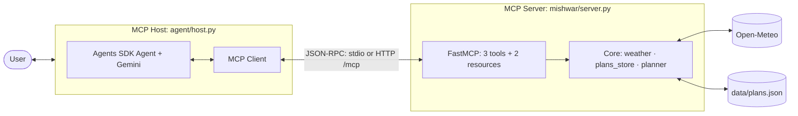

# Mishwar: a weather-aware day-trip planner for Lebanon (MCP toolkit)

*Mishwar* (مشوار) is Lebanese for an outing. Ask the agent about the weather, save a trip, or let it decide whether a trip is a good idea and plan it. It is an MCP server built with **FastMCP** and an agent built with the **OpenAI Agents SDK** acting as the MCP host and client. EECE 503P/798S, Assignment C5.

- 🎬 **Screencast:** *link added after recording (Stage 8)*
- 📝 **Part 1 summary (MCP + Fetch server critique):** [docs/summary.md](docs/summary.md)
- 💭 **Reflection:** [docs/reflection.md](docs/reflection.md)
- 🧭 **Tool design:** [docs/tool_design.md](docs/tool_design.md) · **Challenges:** [docs/challenges.md](docs/challenges.md) · **Architecture:** [docs/architecture.md](docs/architecture.md)

## What it does

Exactly three tools, one per category, plus two read-only resources:

| Tool | Category | Purpose | Inputs | Output | Failure cases (clear errors) |
|---|---|---|---|---|---|
| `get_weather_forecast` | **Data** | Get the daily forecast for one place in Lebanon on one date | `place`, `date` (YYYY-MM-DD, today…+15 days) | `DayForecast`: temps °C, rain %, wind km/h, summary | `PlaceNotFound`, `DateOutOfRange`, `ServiceUnavailable`, `InvalidInput` |
| `save_trip_plan` | **Action** | Save one trip plan to the user's saved plans | `title`, `place`, `date`, `activity`, `notes` | `SavedPlan` with `plan_id` | `DuplicatePlan`, `InvalidInput` (past date…), `StorageError` |
| `plan_day_trip` | **Orchestration** | Get the forecast, judge it for the activity with fixed rules, then save the plan unless it is not recommended | `place`, `date`, `activity` | `TripPlan`: forecast, verdict, reasons, saved, plan_id | the Data tool's errors (nothing saved); storage failure ("plan NOT saved") |

| Resource | Content |
|---|---|
| `trips://plans` | all saved plans, newest first (JSON) |
| `trips://plans/{plan_id}` | one saved plan (JSON) |

`activity` is one of `hike`, `beach`, `sightseeing`, `indoor`. The verdict (`go`, `go_with_caution`, `not_recommended`) comes from a fixed rule table (rain, thunderstorms, wind, heat, cold beach days), never from the LLM. See [docs/tool_design.md §6](docs/tool_design.md).

## Architecture



**Round trip** for "Should I hike in Ehden on Saturday? Plan it.":
1. The **host** reads `trips://plans` and builds the agent's instructions (today's date, saved plans).
2. The LLM sees the three tool schemas and picks `plan_day_trip(place="Ehden", date="2026-10-31", activity="hike")`.
3. The **client** sends a JSON-RPC `tools/call` to the **server** (stdio pipe or HTTP POST).
4. The server calls the orchestration core, which geocodes, fetches the forecast, applies the rules and saves if allowed.
5. The structured result goes back through the client to the LLM, which explains the verdict.

The host prints each hop (`[HOST -> CLIENT] model chose 'plan_day_trip' {...}` / `[CLIENT -> HOST] ... returned: {...}`), and the server logs `<-` requests and `->` results. Full diagrams: [docs/architecture.md](docs/architecture.md).

## Setup

Needs **Python 3.10+** (tested on 3.12, Windows 11) and a free **Gemini API key** from [Google AI Studio](https://aistudio.google.com/apikey), or a local [Ollama](https://ollama.com) model.

**Windows (PowerShell)**
```powershell
git clone https://github.com/Mustafa-Abbara/mishwar-mcp.git
cd mishwar-mcp
py -3.12 -m venv .venv
.\.venv\Scripts\Activate.ps1
pip install -r requirements-dev.txt
copy .env.example .env
notepad .env        # paste your key into LLM_API_KEY
```

**macOS / Linux**
```bash
git clone https://github.com/Mustafa-Abbara/mishwar-mcp.git
cd mishwar-mcp
python3 -m venv .venv
source .venv/bin/activate
pip install -r requirements-dev.txt
cp .env.example .env    # then put your key into LLM_API_KEY
```

Check the setup: `python scripts/check_env.py` prints the versions, and `python scripts/smoke_llm_tools.py` checks that your model can call tools (it prints 29, then 34).

## Run

**Chat (stdio, one terminal).** The host starts the server itself:
```bash
python -m agent.host
```
Try: *"What's the weather in Byblos tomorrow?"*, *"Save a plan called 'Sunset at Raouche' in Beirut on Sunday, sightseeing"*, *"Is next Saturday good for a hike in Ehden? Plan it."*, *"Weather in Atlantis?"*. Type `/plans` to have the host read the `trips://plans` resource, and `exit` to quit.

**Chat over HTTP (two terminals).** The server runs in its own window, so you can watch each request arrive:
```powershell
# terminal 1                                # terminal 2
$env:MCP_TRANSPORT="http"                   $env:MCP_TRANSPORT="http"
python -m mishwar.server                    python -m agent.host
```
(macOS/Linux: `MCP_TRANSPORT=http python -m mishwar.server` and `MCP_TRANSPORT=http python -m agent.host`.) The server listens on `http://127.0.0.1:8000/mcp`.

**Other scripts**

| Command | What it does |
|---|---|
| `python scripts/demo_queries.py` | runs a fixed set of queries (one per tool, a failure, a saved-plans question) |
| `python scripts/smoke_server.py stdio` (or `http`) | talks to the server through the MCP client with no LLM: lists tools/resources and calls each tool |
| `python scripts/explore_fetch.py` | Part 1: explores the reference Fetch MCP server |

**Switches** (in `.env` or the shell): `MISHWAR_SIMULATE_OUTAGE=1` makes every weather call fail, to show the "service down" error. `MISHWAR_OFFLINE=1` answers from saved real responses for 13 places if there is no internet (logged as `OFFLINE MODE`). `MISHWAR_DATA_DIR` sets where `plans.json` lives.

## Tests

| Command | What it proves | Needs |
|---|---|---|
| `pytest` | 90 tests: every core rule and failure case, the server through FastMCP's in-memory MCP client (schemas, errors, resources, masking), the PDF's design rules (exactly 3 tools, documented schemas, annotations, the "and" rule), and the word counts of the summary and the reflection. A fixture blocks the network, so they run offline. | nothing |
| `pytest -m live` | the real Open-Meteo API (every alias resolves) and the whole chain with the real LLM: each request calls exactly the right tool | internet + LLM key |
| `python scripts/eval_routing.py` | routing evaluation: 11 cases × 2 runs, writes `evals/results/` | internet + LLM key |
| `python scripts/eval_routing.py --chaining` | orchestration tool vs letting the LLM chain the other two | internet + LLM key |

Latest results (`gemini-3.5-flash-lite`): **routing accuracy 100% (22/22), failure cases handled 100% (8/8)**. With the orchestration tool, planning took 2.0 LLM calls instead of 2.7 when chaining. Details in [docs/challenges.md §4](docs/challenges.md) and [evals/results/](evals/results/).

## Failure handling

Every expected failure is raised as a typed error and reaches the client as an MCP error result (`is_error: true`). It is never a normal-looking result, unlike notebook 7's `return None`. Messages say what went wrong, which input caused it and how to fix it:

| Error | Example message |
|---|---|
| `PlaceNotFound` | `No place called 'Atlantis' was found in Lebanon. Check the spelling or try the English name of the town or a nearby one, e.g. 'Byblos' or 'Sidon'.` |
| `DateOutOfRange` | `2026-12-01 is outside the forecast window (2026-10-23 to 2026-11-07). Pick a date in that range.` |
| `ServiceUnavailable` | `The weather service (Open-Meteo) did not respond (timed out). Nothing was saved. Try again in a minute.` |
| `DuplicatePlan` | `A plan titled 'Souk walk' on 2026-10-24 already exists (p-3fa9c2d1). Use a different title or date.` |
| `InvalidInput` | `'24/10/2026' is not a date in YYYY-MM-DD format. Convert it first, e.g. '2026-10-24'.` |
| `StorageError` | `The forecast was retrieved (verdict: go) but the plan was NOT saved: Permission denied. Try again.` |

Unexpected bugs are masked (`mask_error_details=True`), so no stack traces reach the client. The full list is in [docs/tool_design.md §5](docs/tool_design.md).

## Design decisions

- **Core layer + thin MCP layer.** All logic lives in plain Python (`weather.py`, `plans_store.py`, `planner.py`); `server.py` only adds schemas and error mapping. The orchestration tool calls the other two *cores* directly, not the tools through MCP, so each tool stays single-purpose and everything is testable without a server or an LLM.
- **Deterministic verdicts.** The LLM explains the verdict but never makes it, so the same forecast always gives the same answer.
- **Geocoding stays inside the Data tool.** "Forecast for a named place" is one job from the caller's side. Taking raw coordinates would push geocoding onto the LLM. A small alias table handles local names the geocoder misses (Jbeil, Tyre, Bcharre).
- **Saved plans are a resource, not a tool.** The host reads `trips://plans` into the agent's instructions, so "what have I saved?" needs no tool call.
- **Safe storage.** Plans are written atomically (temp file + `os.replace`), and duplicates (same title and date) are refused.
- **Robust network calls.** Connections to Open-Meteo are retried, the MCP client timeout is 30 s (the SDK default is 5 s), and LLM rate limits are retried with backoff.

## Switching the model

Edit three lines in `.env`. Any OpenAI-compatible endpoint works:
```ini
# Gemini (default)
LLM_BASE_URL=https://generativelanguage.googleapis.com/v1beta/openai/
LLM_MODEL=gemini-3.5-flash-lite
LLM_API_KEY=your-gemini-key

# Local Ollama (no key; run `ollama pull qwen3:8b` first)
# LLM_BASE_URL=http://localhost:11434/v1
# LLM_MODEL=qwen3:8b
# LLM_API_KEY=ollama
```

## Limitations and next steps

- **Lebanon only and daily granularity:** no hourly forecasts, and the window is limited to 16 days by Open-Meteo.
- **Gaps in the geocoder:** some places (e.g. Jeita) are not in it, and the alias table only covers known spellings.
- **Single-user store:** one local `plans.json` with no authentication. The HTTP transport is meant for localhost.
- **Not yet tested on Ollama:** the fallback model is supported but was not run.
- **Next steps:** a real notification action (e.g. ntfy or email), per-user stores and auth for a deployed HTTP server, forecast caching, more activities, a calendar export, and a `geocode_place` tool if the toolkit grows.

## Credits

- Weather and geocoding data: [Open-Meteo.com](https://open-meteo.com/), licensed under [CC BY 4.0](https://creativecommons.org/licenses/by/4.0/). Geocoding is based on GeoNames.
- Built with [FastMCP](https://gofastmcp.com) 4.1.3, the [OpenAI Agents SDK](https://openai.github.io/openai-agents-python/) 0.24.0 and the [Model Context Protocol](https://modelcontextprotocol.io).
- Course: EECE 503P/798S Agentic Systems, assignment "C5: Agent Tools".
