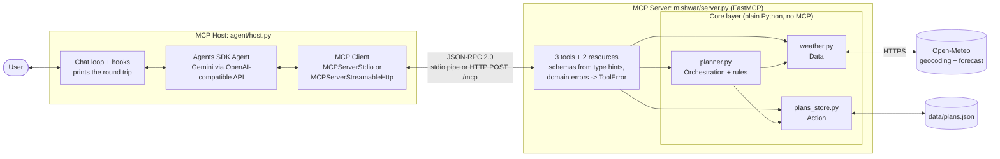
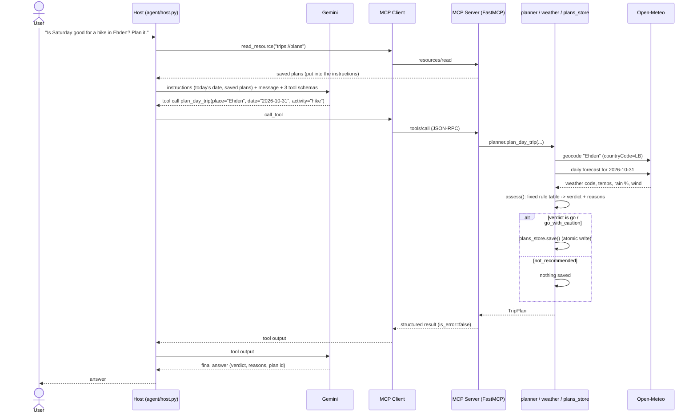

# Architecture

## Components

- **Host** (`agent/host.py`): the application the user talks to. It holds the agent, prints each tool call, and reads the `trips://plans` resource itself (for the agent's instructions and the `/plans` command).
- **Client** (inside the host): one dedicated connection to the one server. `MCPServerStdio` starts the server as a child process; `MCPServerStreamableHttp` connects to a server already running at `http://127.0.0.1:8000/mcp`.
- **Server** (`mishwar/server.py`): a thin FastMCP layer. Each tool calls one core function; nothing in it knows about weather rules or files.
- **Core** (`mishwar/`): all the logic, tested without MCP or an LLM. The orchestration core calls the other two cores **directly as Python**, never through MCP, so the tools stay independent.

## One request end to end: `plan_day_trip`

If anything fails (unknown place, date outside the window, Open-Meteo down, file not writable), the core raises a domain error. The server turns it into a `ToolError`, the client receives `is_error=true` with the message, and the LLM explains it to the user. If the forecast fails, nothing is saved.

## Transports

| | stdio (development) | Streamable HTTP (demo) |
|---|---|---|
| Who starts the server | the host, as a child process | you, in its own terminal |
| Command | `python -m agent.host` | `MCP_TRANSPORT=http python -m mishwar.server`, then `MCP_TRANSPORT=http python -m agent.host` |
| Where server logs appear | mixed into the host's terminal (stderr) | in the server's own window, so you can watch each request arrive |
| Settings | forwarded by `config.server_env()` (the stdio client passes only a minimal environment) | read from `.env` by the server process |

The same server code serves both; `MCP_TRANSPORT` picks one.
